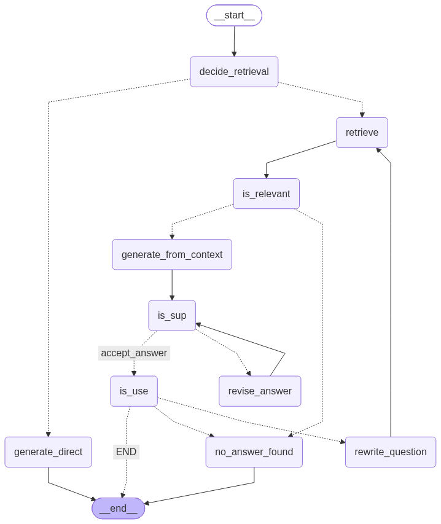

# CloudOps Sentinel
### An AI-Powered Incident Response Assistant using Self-RAG and LangGraph

CloudOps Sentinel is an AI-powered incident response assistant designed to help engineering and operations teams investigate infrastructure incidents using internal runbooks, technical documentation, and external knowledge.

It uses a **Self-RAG architecture built with LangGraph** to make retrieval decisions, evaluate retrieved information, rewrite queries when necessary, verify answer grounding, and iteratively improve responses.

The system combines private knowledge-base retrieval with optional web search to provide context-aware responses while attempting to reduce unsupported or irrelevant answers.

---

## Key Features

- **Self-RAG Workflow:** Uses a stateful LangGraph workflow to decide when retrieval is necessary and evaluate the quality of retrieved information.
- **Adaptive Retrieval:** Retrieves information from an internal knowledge base and can fall back to external web search when additional context is required.
- **Document Relevance Evaluation:** Evaluates retrieved documents before using them to generate an answer.
- **Query Rewriting:** Rewrites queries when the initial retrieval does not provide sufficiently relevant information.
- **Grounding Verification:** Evaluates whether generated responses are supported by retrieved context and can trigger iterative answer revision.
- **Multi-format Document Ingestion:** Supports PDF, TXT, Markdown, and DOCX documents.
- **Persistent Conversation State:** Uses LangGraph checkpointing with SQLite to maintain conversation state across interactions.
- **Audit Logging:** Stores application interaction records using SQLite.
- **REST API:** Provides a FastAPI backend for conversational queries, document ingestion, health checks, and audit access.

---

## Architecture

The application follows a graph-based architecture where individual nodes perform specific retrieval, evaluation, and generation tasks.

### Architecture 


*The diagram represents the intended workflow at a high level. Actual routing and termination conditions are defined by the graph implementation.*

### Main Components

| Component | Responsibility |
|---|---|
| LangGraph | Workflow orchestration and conditional routing |
| LangChain | LLM and retrieval integrations |
| Gemini | Embeddings and language-model capabilities |
| Pinecone | Vector storage and similarity retrieval |
| Tavily | Optional external web search |
| FastAPI | Backend API |
| SQLite | Conversation checkpointing and audit storage |

---

## Technology Stack

- **Language:** Python
- **Agent Framework:** LangGraph
- **LLM Framework:** LangChain
- **LLM / Embeddings:** Google Gemini
- **Vector Database:** Pinecone
- **Web Search:** Tavily
- **Backend:** FastAPI
- **Persistence:** SQLite
- **Document Processing:** PDF, DOCX, TXT, Markdown

---

## Project Structure

The project is organized around the API, document ingestion, retrieval workflow, and supporting infrastructure.

```text
cloud-ops/
│
├── documents/
│   └── ...                 # Knowledge-base documents
│
├── src/
│   ├── ...                 # Application source code
│   ├── ...                 # LangGraph workflow
│   ├── ...                 # Retrieval and ingestion logic
│   └── ...                 # API and supporting modules
│
├── .env.example
├── .gitignore
├── requirements.txt
└── README.md
```

*Adjust the structure above to match the actual repository layout before publishing.*

---
## Getting Started

### 1. Clone the repository

```bash
git clone https://github.com/bhaveshUp2010/Cloud-Ops.git
cd Cloud-Ops
```

### 2. Install uv

If you don't already have uv installed, follow the official installation instructions:

https://docs.astral.sh/uv/getting-started/installation/

### 3. Create the virtual environment and install dependencies

```bash
uv sync
```

This creates the project virtual environment and installs dependencies from the lockfile and project configuration.

### 4. Configure environment variables

Create a `.env` file in the project root:

```env
GOOGLE_API_KEY=your_google_api_key
PINECONE_API_KEY=your_pinecone_api_key
TAVILY_API_KEY=your_tavily_api_key
```

Tavily is optional if external web search is disabled.

Never commit your `.env` file or API credentials.

### 5. Ingest knowledge-base documents

Place your operational runbooks and other supported documents in the configured document directory.

Run the ingestion script using uv:

```bash
uv run python -m scripts.ingest
```

Replace `scripts.ingest` with the actual ingestion module name in the repository.

### 6. Start the application

For example, if the FastAPI entry point is `src.main:app`:

```bash
uv run uvicorn src.main:app --reload
```

Access the interactive API documentation at:

```text
http://localhost:8000/docs
```

### Useful uv commands

| Command | Purpose |
|---|---|
| `uv sync` | Install project dependencies |
| `uv add package-name` | Add a dependency |
| `uv remove package-name` | Remove a dependency |
| `uv run python script.py` | Run a Python script |
| `uv lock` | Update the lockfile |


### 5. Add knowledge-base documents

Place the internal runbooks, operational documentation, and other supported documents in the configured document directory.

Run the document ingestion process provided by the project to:

1. Load supported document formats.
2. Split documents into chunks.
3. Generate embeddings.
4. Store vectors and associated metadata in Pinecone.

### 6. Start the application

Start the FastAPI application using the entry point configured in the repository.

For example, if the application entry point is `src.main:app`:

```bash
uvicorn src.main:app --reload
```

The API documentation can then be accessed through:

```text
http://localhost:8000/docs
```

---

## API Capabilities

The backend exposes endpoints for the following operations:

| Operation | Description |
|---|---|
| Health | Check application availability |
| Chat | Submit questions to the incident-response assistant |
| Upload | Upload and ingest knowledge-base documents |
| Audit | Access stored interaction audit records |

Refer to the FastAPI interactive documentation at `/docs` for the actual endpoint paths, request schemas, and response formats.

---

## Design Considerations

### Stateful Workflow Execution

LangGraph manages the execution of the Self-RAG workflow. SQLite checkpointing allows graph state to persist between interactions associated with a conversation thread.

### Retrieval Quality

Instead of blindly passing retrieved documents to the language model, the workflow evaluates document relevance and can rewrite queries when retrieval results are insufficient.

### Answer Reliability

The workflow includes grounding evaluation and answer revision to reduce unsupported responses. These LLM-based checks are safeguards, not a guarantee that every answer is factually correct.

### Separation of Responsibilities

The application separates document ingestion, retrieval, graph orchestration, API handling, and persistence responsibilities.

---

## Current Limitations and Future Improvements

The project is an evolving engineering prototype. Areas for further development include:

- Implementing a quantitative retrieval and answer evaluation pipeline.
- Comparing similarity retrieval against hybrid search and reranking.
- Adding metadata filtering for service-specific runbooks.
- Improving graph termination and failure-handling behavior.
- Adding automated tests for graph routing, API endpoints, and conversation isolation.
- Introducing structured observability for latency, token usage, and model costs.
- Strengthening document-upload validation and API security.
- Adding containerization and a reproducible deployment pipeline.

---

## Why This Project?

CloudOps Sentinel explores how retrieval-augmented generation can be extended beyond a conventional RAG pipeline through stateful orchestration, retrieval evaluation, conditional execution, and answer verification.

The goal is to build a more reliable AI assistant for operational knowledge retrieval and incident investigation.

---

## Author

**Bhavesh Upadhyay**

GitHub: [@bhaveshUp2010](https://github.com/bhaveshUp2010)

Project Repository: [CloudOps Sentinel](https://github.com/bhaveshUp2010/Cloud-Ops)
